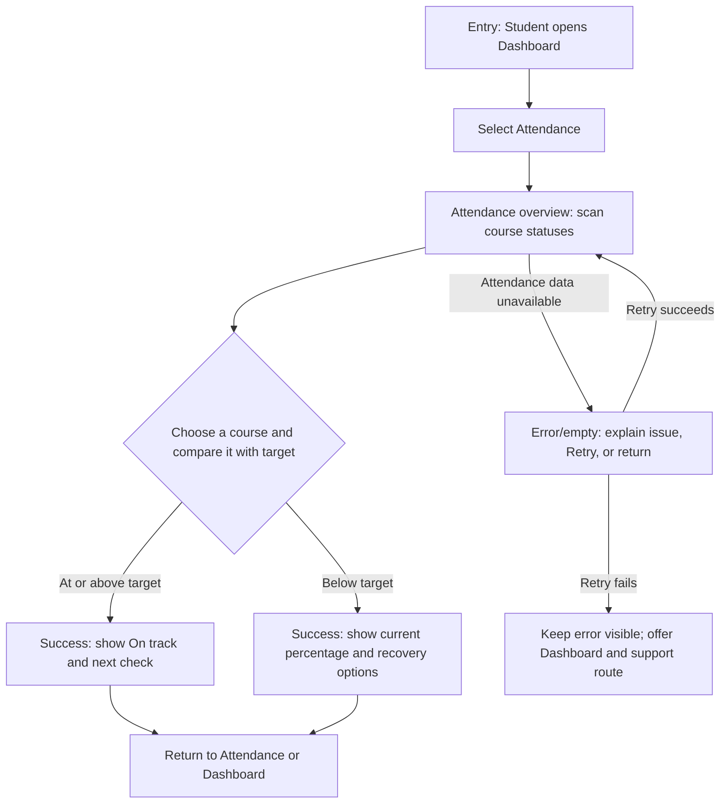
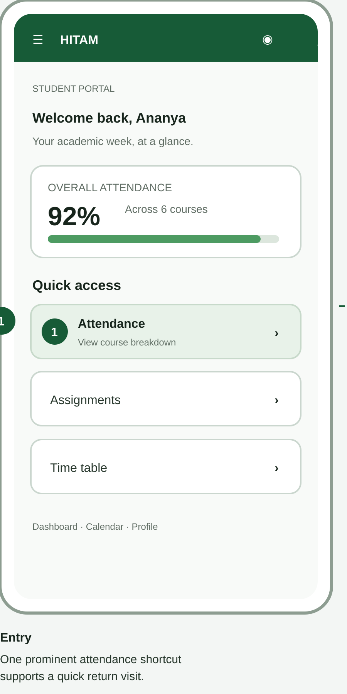
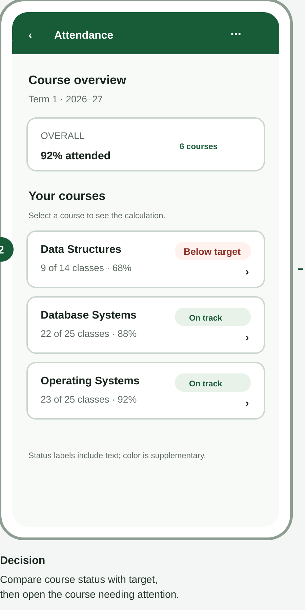
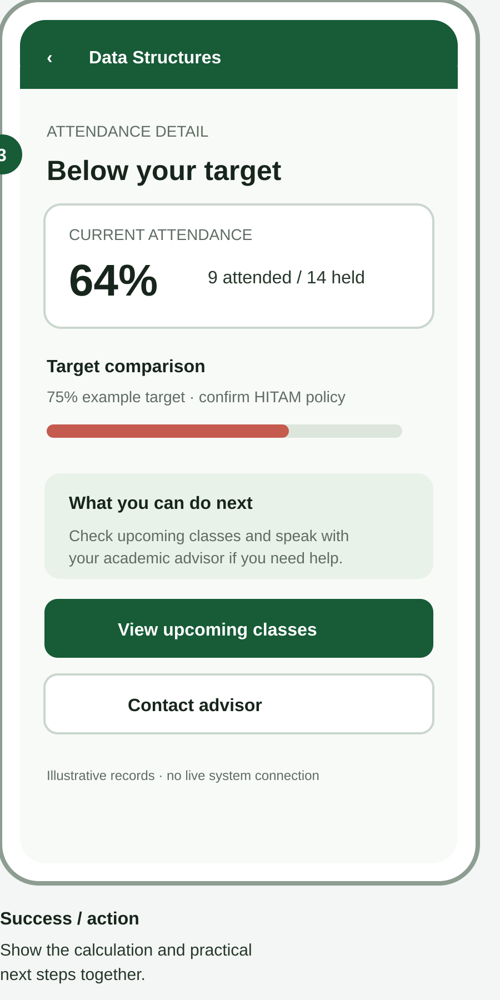
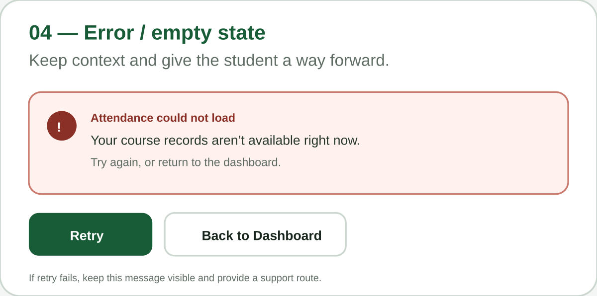
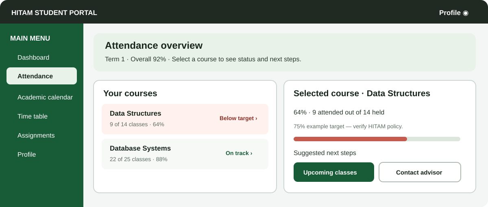

# HITAM Student Portal — Information Architecture & Wireframes

**Task 03 · Low-fidelity, mobile-first concept**  
**Primary journey:** Find a course with attendance below the student’s target and decide what to do next.

> **Design basis:** This concept extends the existing HITAM student-portal prototype. No interview responses or completed Task 02 research were available in the project files, so the rationale below is a documented heuristic hypothesis, not a claim about interviewed students. All names, counts, and percentages shown are illustrative. The 75% target is a placeholder for wireframing and must be checked against official HITAM policy before implementation.

## Short explanation

Attendance is a time-sensitive academic task. The dashboard therefore offers a direct route into attendance, the attendance screen groups courses with their status, and a course detail screen explains the number behind the status and offers a next step. The global menu remains available for returning students. On small screens, course rows become stacked cards with clear labels; on desktop, the same information sits beside persistent navigation.

## Primary user journey

**Decision rule:** The prototype compares each course with a configurable target. The 75% value in the wireframe is a placeholder only; the finished product should use the institution’s verified policy and explain it beside the comparison.

## Sitemap / screen inventory

| Screen | Purpose and key content | Main action / state |
|---|---|---|
| Dashboard (entry) | Welcome, academic summary, quick links | Open Attendance |
| Attendance overview | Overall summary and course-by-course status | Select a course; empty/error state if records cannot load |
| Course attendance detail | Attended/held counts, percentage, target context | Review missed classes or support options |
| On-track result | Reassurance and next review suggestion | Return to overview/dashboard |
| Below-target result | Clear status and practical next steps | Check upcoming classes or contact advisor |
| Load error / empty state | Plain explanation, retry, safe navigation | Retry; if it fails, go to Dashboard or support |

**Grouping rationale:** Attendance summary and course rows belong together because students scan across courses before opening one. Counts and the percentage are grouped on the detail screen because the percentage alone does not explain how it was calculated. Recovery actions follow the status so a student can act without searching another section.

## Mobile-first wireframes and desktop adaptation

The diagram is intentionally low fidelity: it focuses on hierarchy, labels, content grouping, and state changes rather than final brand styling.

### Mobile screens

**01 · Dashboard entry**

**02 · Attendance overview and course choice**

**03 · Course detail and next steps**

**04 · Data unavailable error**

### Desktop adaptation

## Interaction and accessibility notes

- Use visible text labels with every status; color or icons alone do not communicate “below target.”
- Keep the error message beside the affected attendance content and preserve a clear Retry action.
- Make the course row a full, keyboard-operable target with a visible focus state in the high-fidelity design.
- Use a single clear page heading, descriptive control labels, and readable text at mobile widths.
- Keep the target explanation adjacent to the comparison; do not imply that the placeholder is official policy.

## Assumptions to validate in the next research step

1. Students look for attendance from the dashboard when deciding whether to act.
2. Course-level status is more useful for action than an overall percentage alone.
3. Students need both the calculation (classes attended/held) and a next step.
4. The institution’s attendance threshold, terminology, and escalation path must be confirmed with HITAM.

**Prototype limitation:** This is a static wireframe deliverable; buttons and data are illustrative and do not submit requests to HITAM systems.
