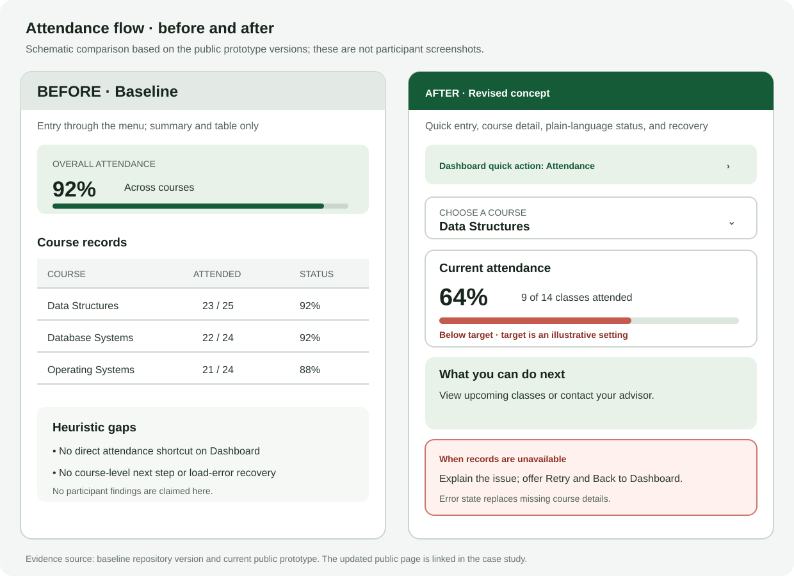

# HITAM Student Portal Redesign — Usability Test & Case Study

**Task 05 · Case-study draft, awaiting three real user sessions**  
**Interactive prototype:** [Open the public HITAM portal](https://hitam-student-app-redesign-hzapp6mecm8fcswqcuui3nn.streamlit.app/)  
**Current testing state:** The test plan and revised prototype are ready. Three-participant sessions have not been completed, so this draft reports no participant findings or completion rates.

> **Important:** Do not present this as completed user testing until the anonymous session sheet below has real observations for three testers. The prototype revisions currently shown are based on the prior accessibility work and a documented heuristic walkthrough, not fabricated participant feedback.

## Short explanation

This case study follows one student goal: check course attendance and decide what to do next. Earlier iterations defined the flow, added a forest-green design system, and built an interactive attendance prototype. This final step packages the before/after evidence, five moderated task scenarios, measurable success criteria, and an anonymous results sheet. The next revision will be based on real session evidence.

## Project overview

- **Product:** HITAM Student Portal redesign concept
- **Target user:** A student who checks academic status, attendance, schedules, and course feedback on a phone or laptop.
- **Primary journey:** Dashboard → Attendance → choose a course → understand its status → take an appropriate next step.
- **Scope:** The prototype is a visual interaction concept. It is not connected to HITAM records.
- **Content:** All student names, classes, percentages, schedules, and other records are illustrative.

## Evidence and decision trail

| Evidence | What it suggested | Design decision | How to validate |
|---|---|---|---|
| In the initial screenshot review, the requester said headings blended into the background and asked for dark text on a white surface. | Text and surface contrast must be obvious at a glance. | Established dark ink on a light canvas, forest green actions, semantic feedback colors, and a live contrast checker. | Verify text/control pairs against the AA thresholds; observe whether testers can read and interpret status labels. |
| The portal task flow includes attendance, timetable, assignments, and feedback. | A student needs a short route from status to action. | Made Attendance a direct Dashboard quick action and added course detail with timetable/advisor routes. | Measure unassisted completion and time for Tasks 1, 2, and 4. |
| Heuristic walkthrough of the previous Attendance page: it showed an aggregate metric and a plain course table, without a course-level recovery step or an unavailable-record state. | A percentage alone does not explain what to do, and missing data needs recovery. | Added selectable course detail, attended/held counts, visible status text, next steps, and a simulated load-error state with Retry and Dashboard actions. | Measure whether testers interpret the number and recover from Task 3 without moderator help. |
| Earlier wireframe work used 75% as a placeholder; no official HITAM attendance rule was verified. | A prototype value could be mistaken for college policy. | Label the control as a preview target and disclose that policy needs verification. | Ask testers what they think the threshold represents; confirm it with HITAM before any production use. |

The heuristic walkthrough is a design inspection, not a user study. No participant observations are claimed in this table.

## Before and after

The comparison below reconstructs the baseline from the earlier repository version and the updated flow from the current public prototype. It is a schematic, not a participant screenshot.

### What changed

- **Before:** dashboard access relied on the main menu; the Attendance page showed an aggregate and a plain table.
- **After:** Dashboard has a prominent Attendance shortcut; students select a course, see the calculation and text status, and get a next step.
- **Recovery:** an unavailable-record preview shows an explanation plus Retry and Back to Dashboard, replacing the unavailable course detail.
- **Accessibility:** color is paired with status text, controls have visible labels, the green-on-light and white-on-green pairs meet the documented contrast targets, and the app uses native keyboard-operable controls.

## Five moderated usability tasks

Read each scenario as written. Let the participant work without hints unless they ask to stop. Start a timer at the end of the prompt; record the first meaningful hesitation, wrong turn, and recovery. Do not collect names, email addresses, student IDs, grades, or personal comments.

| # | Scenario to read | Success measure | Time target |
|---:|---|---|---:|
| 1 | “You want to check whether Data Structures needs attention. Starting from the dashboard, find its current attendance and tell me what the portal says.” | Reaches Attendance, selects Data Structures, and reports **64%** and **Below target** without a hint. | ≤60 sec |
| 2 | “You are checking Database Systems. Is it on track against the example target shown here?” | Selects Database Systems, finds **88%**, and correctly interprets the visible status as on track for the current preview target. | ≤45 sec |
| 3 | “Attendance records are temporarily unavailable. Show me how you would recover.” | Moderator turns on the error-preview switch before the task. Participant explains the error, chooses Retry, and sees course details return; no hint. | ≤45 sec |
| 4 | “You want to see when Data Structures meets. Starting from its attendance details, find its timetable entries.” | Uses the timetable action, identifies at least one Data Structures time slot, and returns or explains where they are. | ≤60 sec |
| 5 | “You want to leave course feedback. Choose a term, give a rating, and submit a short non-personal comment.” | Completes the labeled form, sees confirmation, and understands that this concept does not send or save the feedback. | ≤90 sec |

**Overall success criteria:** Record completion for each task as unassisted, completed with a hint, or not completed. Track time, wrong turns, and critical errors separately. For the three-person sample, the initial design goal is at least **2 of 3 unassisted completions per task** and **zero critical errors**; any task with fewer than 2 unassisted completions, repeated confusion, or a critical error becomes a revision candidate. This small sample is directional and is not statistically representative.

## Session protocol and anonymous observation sheet

### Moderator opening

“I’m evaluating the prototype, not you. Some content is sample data and nothing is sent to HITAM. Please think aloud as you go. You can stop at any time. I’ll take anonymous notes and won’t record your name or student details.”

Use participant codes **P1**, **P2**, and **P3** only. Record device class (phone/laptop) and broad familiarity (new/occasional/frequent) only if the participant agrees. Do not record identifying or sensitive details. Ask neutral follow-ups such as “What are you expecting here?” or “What would you do next?”

Before each session, open a fresh browser session, leave the attendance target at its default 75, and leave the unavailable-record preview switched off. For Task 3 only, the moderator should turn on the preview switch immediately before reading the task prompt; do not explain what the screen should say.

### Participant results — fill only after real sessions

For each cell, record `U` (unassisted), `H` (needed a hint), or `N` (not completed), plus elapsed time. Add a brief, anonymous observation in the notes column. Leave untested cells blank.

| Participant code | Device / familiarity (optional, broad only) | Task 1 | Task 2 | Task 3 | Task 4 | Task 5 | Most important hesitation or quote paraphrase |
|---|---|---|---|---|---|---|---|
| P1 |  |  |  |  |  |  |  |
| P2 |  |  |  |  |  |  |  |
| P3 |  |  |  |  |  |  |  |

### Observation log

Duplicate this row for each observation. Write what happened, not an interpretation alone. Do not include personal data.

| Participant | Task | Observed action / hesitation | Expected result (participant’s words or paraphrase) | Outcome / time / hint | Design implication |
|---|---|---|---|---|---|
|  |  |  |  |  |  |

## Issue prioritization

The current items below are **heuristic review candidates**, not user-test findings. After the sessions, replace or reorder them based on severity, frequency, and task impact.

| Priority | Candidate issue | Evidence source | Current response | Revisit after sessions |
|---|---|---|---|---|
| P1 | Students may overlook the attendance destination when they start at Dashboard. | Heuristic walkthrough of the previous navigation. | Prominent Attendance quick action added to Dashboard. | Check Task 1 route and time; keep or change the shortcut based on observed behavior. |
| P1 | An aggregate/table view may not help a student decide what to do for one course. | Baseline interface inspection; not a participant result. | Course selector, attended/held calculation, text status, and next-step actions added. | Check Tasks 1, 2, and 4 for misinterpretation, status comprehension, and action choice. |
| P1 | Unavailable records previously had no explicit recovery state. | Baseline interface inspection. | Added error message, Retry, and Back to Dashboard. | Check Task 3; note whether testers recognize the error and recover. |
| P2 | The 75% example can be mistaken for official policy. | Policy source not available in the project. | Labeled as a preview-only placeholder. | Verify with HITAM; test participant understanding of the label. |

## Revision log

| Revision | Change | Reason | Evidence status |
|---|---|---|---|
| R1 | Replaced the Attendance-only aggregate/table screen with a course selector, detail summary, status, and contextual next steps. | Improve course-level decision support and support the required primary journey. | Heuristic design decision; awaiting user validation. |
| R2 | Added a recoverable unavailable-record state with Retry and Dashboard navigation. | Make the failure path explicit and recoverable. | Heuristic design decision; the interaction is present in the prototype, awaiting user validation. |
| R3 | Added an Attendance quick action to the Dashboard. | Reduce navigation effort to the main task. | Added during this iteration; test against Task 1. |
| R4 | Paired status color with text and labeled the 75% target as illustrative. | Avoid color-only communication and unsupported policy claims. | Contrast pairs documented; policy remains unverified. |

## Limitations and next step

- Three participant sessions and their observations are still required before this can be presented as a completed usability study.
- The sample is small; report counts and examples, not broad claims about all HITAM students.
- Confirm the real attendance threshold, schedule, and student-support route with HITAM.
- The prototype is not connected to student records and does not persist feedback.
- After entering the three real sessions above, revise the highest-impact issue and update the before/after evidence with the observed change.

## Supporting project work

- [Task 03 — Information architecture and wireframes](TASK3_IA_WIREFRAMES.md)
- [Task 04 — Accessible design system](DESIGN_SYSTEM.md)
- [Prototype source repository](https://github.com/super-mkguy/hitam-student-portal-redesign)
- [Open the interactive prototype](https://hitam-student-app-redesign-hzapp6mecm8fcswqcuui3nn.streamlit.app/)

## Task guide

Prepared against the supplied [Usability Test and Portfolio Case Study brief](https://edvyro.in/datasets/task-kits/ui-ux-design-task-4.html) and the [student support design brief](https://edvyro.in/datasets/source-materials/task-source-library.html#ui-ux). The supplied task-kit URLs were not accessible through the web reader at the time of preparation; the checklist above follows the requirements included in the assignment prompt.
