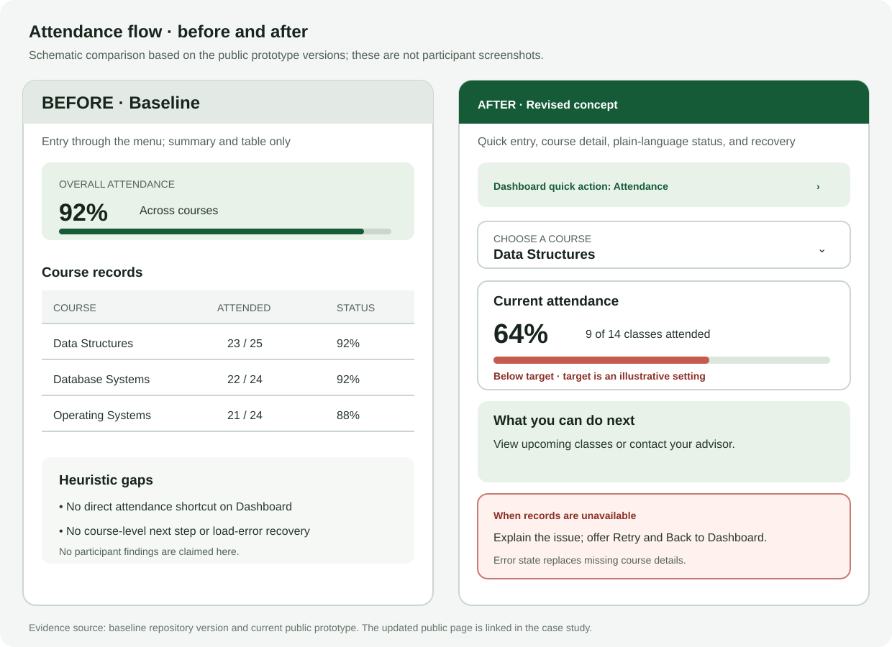

# Task 05 — Usability Test & Portfolio Case Study

**Project:** HITAM Student Portal redesign concept  
**Testers:** Three individual testers, anonymized as P1–P3  
**Primary journey:** Dashboard → Attendance → choose a course → understand status → take a next step

This page records the task scenarios, measurable success criteria, anonymized outcomes, prioritized usability issues, and prototype revisions for Task 05. The prototype is illustrative and is not connected to HITAM systems.

## Five tasks and success measures

| # | Scenario | Success measure | Time goal |
|---:|---|---|---:|
| 1 | Starting from the dashboard, find Data Structures attendance and say what the portal reports. | Find the course and report 64% and “Below target.” | ≤60 sec |
| 2 | Check whether Database Systems is on track against the example target. | Find 88% and interpret its visible status correctly. | ≤45 sec |
| 3 | With the unavailable-record preview enabled, show how to recover. | Understand the error, retry, and see course details return. | ≤45 sec |
| 4 | From attendance details, find when Data Structures meets. | Open the timetable and identify a course time. | ≤60 sec |
| 5 | Choose a term, give a rating, and submit a short non-personal comment. | Complete the form and see the confirmation. | ≤90 sec |

The initial target was at least 2 of 3 unassisted completions per task, with zero critical errors. Times and hesitation details were not captured in these sessions.

## Results from three testers

| Task | P1 | P2 | P3 | Summary |
|---|---|---|---|---|
| 1 · Find attendance | Found | Found | Found | 3/3 found it; hint use and time were not recorded. |
| 2 · Check target | Needed a hint | Needed a hint | Needed a hint | 3/3 needed a hint; hint wording and point of confusion were not recorded. |
| 3 · Recover | Not completed | Not completed | Not completed | 0/3 completed it; exact blocker and time were not recorded. |
| 4 · Find timetable | Found | Found | Found | 3/3 found it; hint use and time were not recorded. |
| 5 · Submit feedback | Submitted successfully | Submitted successfully | Submitted successfully | 3/3 submitted; hint use and time were not recorded. |

Task 2 had 0/3 reported unassisted completions because all three needed a hint. Task 3 had 0/3 completions. The notes confirm completion for Tasks 1, 4, and 5 but do not establish whether help was used. No personal details or participant quotes were collected in the notes provided.

## Before and after

This is a schematic based on project versions, not a participant screenshot.

### Priorities and revisions

1. **Task 3 — highest priority:** All three testers were unable to complete the recovery task. The exact blocker is unknown. The prototype now explains the recovery choices and makes Retry the primary action. Re-test and record where the attempt stops.
2. **Task 2:** All three needed a hint. The hint wording and confusion point were not recorded. The attendance page now explains “at or above” versus “below target” and states the percentage is only an example, not confirmed HITAM policy. Re-test to see if this helps.
3. **Measurement:** Record hint use and elapsed time on every task in the next round. Do not treat success on Tasks 1, 4, or 5 as unassisted without that information.

These UI changes are provisional; there is no follow-up evidence yet that they fixed the problems.

## Scope and sources

- [Open the interactive prototype](https://hitam-student-app-redesign-hzapp6mecm8fcswqcuui3nn.streamlit.app/)
- [Source repository](https://github.com/super-mkguy/hitam-student-portal-redesign)
- [Detailed case study and session protocol](../../TASK5_CASE_STUDY.md)

Course names, attendance percentages, schedules, and feedback are illustrative. The attendance threshold, student-support route, and any production use must be verified with HITAM. The app does not connect to student records or persist feedback.
